# Ship manual (milestone 2026-10-21)

Handbook-style overview of every ship class, existing and planned. Blueprint plates are **generated from the current
voxel model data** (orthographic-style renders, silhouette + shading edges, measured overall dimensions); they document
the models, they are not independent design drawings. `tools/render_ships.py` generates the per-ship views;
`tools/render_pack.py` generates faction contact sheets. Their PNG output is git-ignored and should not be committed.

Current ship stats live in `data/db.json`. Lengths shown here are in-game sizes after runtime scaling in
`src/32_scale.js`; use `python3 tools/export_db.py` for generated detailed ship and weapon tables.

## 1. Scale ladder (owner decision 2026-10-21)
**Current scope: ships under 500 m, plus one exception (owner decision 2026-10-22): the FROGG Bullfrog, 600 m, `cls: 'capital'`, jump-capable.** The frigate (up to ~500 m) is otherwise the largest class for now, can jump, and can dock (not
repair) 2 corvettes and 12 fighters / large fighter drones. Everything else above 500 m in the table is deferred.
| Class | Length | Status |
|---|---|---|
| Fighter / interceptor | 10-20 m | built (Kestrel, Darter, Leaper) |
| Gunship / bomber / heavy fighter | 16-22 m | built (Spitter, Toad, Reaver, Bittern) |
| Corvette | 100-150 m | built (Halberd 128 m, Gulper 146 m) |
| Frigate (jump-capable, in scope) | 300-500 m | human Exeter class built (450 m); FROGG frigate planned |
| FROGG Bullfrog (explicit exception) | 600 m | built (spine lance, 25 turrets, 36-fighter hangar; docs/BULLFROG.md) |
| Human carrier / dreadnought | ~1.5 km | deferred (beyond current 500 m cap) |
| Hive carrier | 2-3 km | deferred; catalogue model exists at 2.5 km |
| Super capital (human) | ~5 km | deferred |
| Hive mothership | ~10 km | deferred |
Only the frigate class and up have jump drives (docs/FLEET_LOGIC.md section 8). Implications of the km scale are in
`docs/CAPITAL_COMBAT.md` (ranges, speeds, sim, voxel budget).

## 2. Ship list
### Built
| Ship | Side | Class | Role | Length | Max speed |
|---|---|---|---|---|---|
| Kestrel | human | fighter | multirole fighter | 12.4 m | 150 m/s |
| Bittern | human | fighter | torpedo bomber (URL-only: `?sk=bittern:2`) | 22 m | 90 m/s |
| Falchion | human | fighter | two-seat heavy fighter (skirmish player / wingman) | 19.5 m | 118 m/s |
| SAR cutter | human | fighter (shuttle) | unarmed rescue ship (skirmish player only) | 32 m | 95 m/s |
| Halberd | human | corvette | escort / mothership | 128 m | 28 m/s |
| Claymore | human | capital | destroyer (skirmish escort capital) | 600 m | 28 m/s |
| Argosy | human | frigate | unarmed evacuation liner (skirmish escort capital) | 450 m | 16 m/s |
| Darter | FROGG | fighter | interceptor | 9.5 m | 165 m/s |
| Leaper | FROGG | fighter | line fighter | 13.6 m | 120 m/s |
| Spitter | FROGG | fighter (gunship role) | maser gunship | 16 m | 90 m/s |
| Toad | FROGG | fighter (bomber role) | torpedo bomber | 19 m | 78 m/s |
| Reaver | FROGG | fighter (heavy role) | heavy fighter | 19 m | 95 m/s |
| Gulper | FROGG | corvette | escort corvette | 146 m | 34 m/s |
| Exeter class | human | frigate | jump frigate, docks 2 corvettes + 12 fighters/drones (no repair) | 450 m | 30 m/s |
| Bullfrog | FROGG | capital | spine carrier: XL forward lance, 1 L + 6 M + 10 S + 8 PD turrets, 16 ST-2 torpedoes, hangar of 36 fighters, jump drive (exception to the 500 m cap) | 600 m | 22 m/s |
| Hive Carrier | FROGG | capital | super carrier, unarmed catalogue model (deferred, over 500 m cap) | 2,500 m | 12 m/s (placeholder) |
Note: the Spitter/Toad/Reaver have `cls: 'fighter'` in data; a separate role field is needed once class masks exist.
### Planned (no models yet)
Human drone wingman (large fighter drone), FROGG frigate, human carrier (~1.5 km, deferred), human dreadnought (~1.5 km, deferred), human super capital (~5 km, deferred),
tender / SAR ship, freighter/tanker, station/drydock; FROGG frigate, FROGG mothership (~10 km), brood-spawn drones.
Human factions with distinct ships: deferred until the back story exists (docs/LORE.md).

## 3. Voxel overview and scale
**Subsystem positions (rule, owner 2026-10-21): every model view and blueprint shows its subsystems.** Marker key:
engine = orange ring, main gun = green square, PD turret = yellow triangle, shield generator = cyan diamond,
sensors/bridge = magenta ring, reactor = red cross, radiator = white panel, fighter bay / corvette cradle = purple box,
weapon muzzle = green plus; faint rings show hit-zone radius (blueprint elevations only).
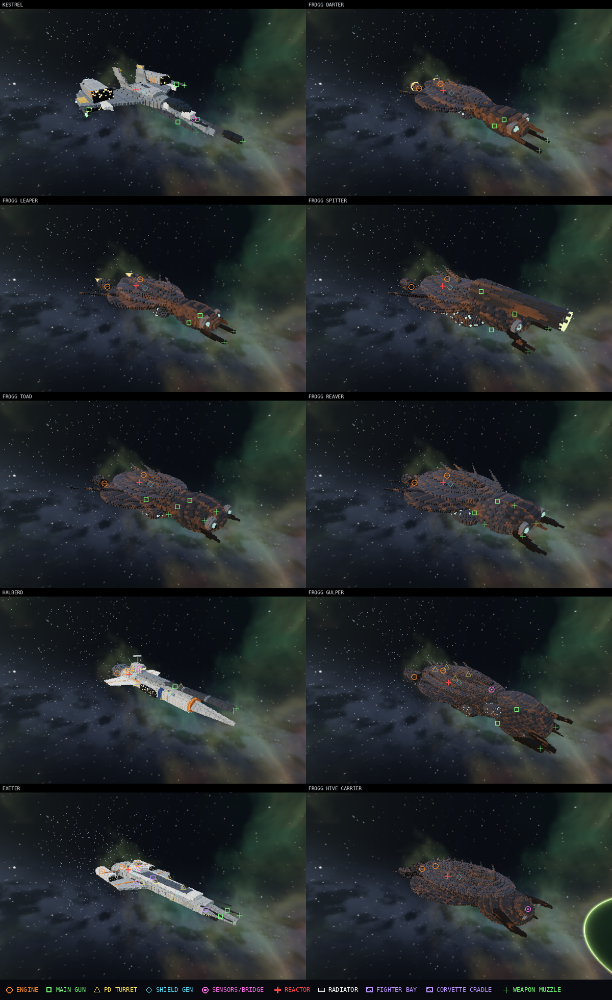
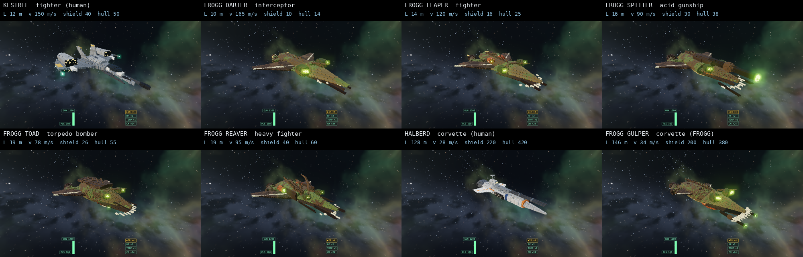
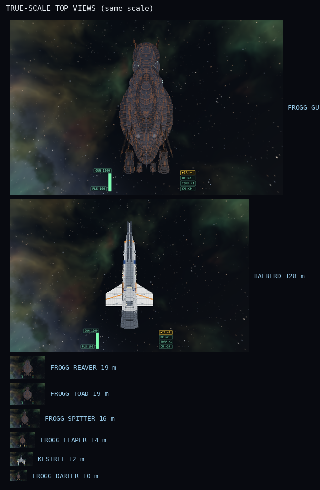
Earlier FROGG look (insect/frog) for comparison: `img/ship_classes_grid_before_frogg_v2.png`.

## 4. FROGG design language (v2, after owner feedback)
Reference images (owner-supplied concept art, style orientation only, not copied): dark lamellar plating with rust
streaks, swept trailing blades, ribbed red-orange engine vents, layered carapace shells, keel spikes.
Feedback applied: the first pass looked insectoid because of large pearl "eye" discs and curved mandibles; both were
removed. Current elements: stacked armour plates, flush sensor clusters, short prow blades, dorsal spikes, ventral keel,
nacelles with orange vents, small pale lights on pods. Weapons stay venom-green so enemy fire remains readable.
Palette changed 2026-10-21 to cool dark grey-green with rust only as accent (the scene hemisphere light has a brown ground colour that still warms downward faces); open: hangar maws, radiator-like structures and hardpoints
need work on the capital models.

## 5. Blueprint plates (with subsystem markers)
Each plate: side elevation, front elevation, plan, 3/4 view, overall measured dimensions, stats.
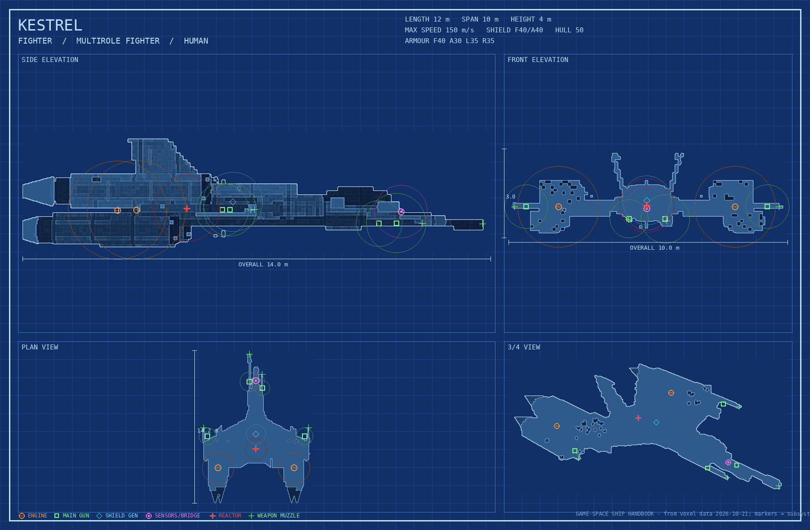
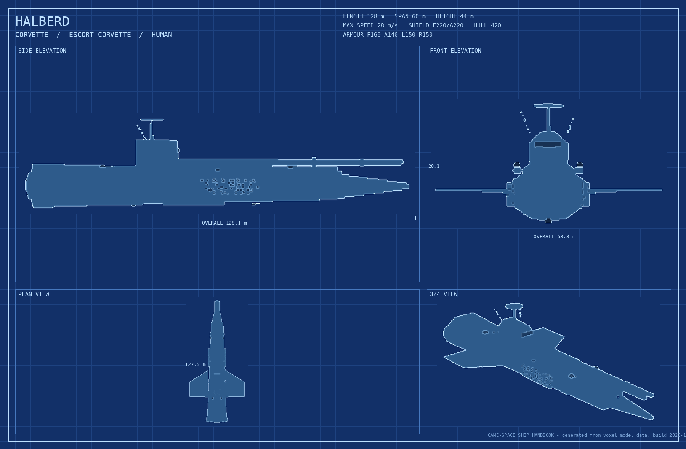
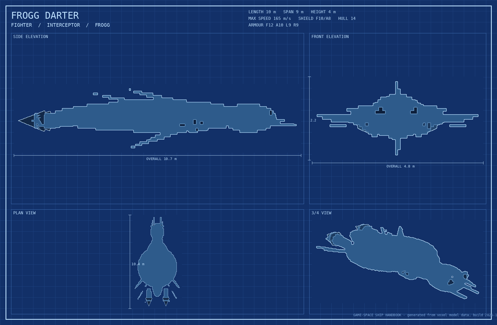
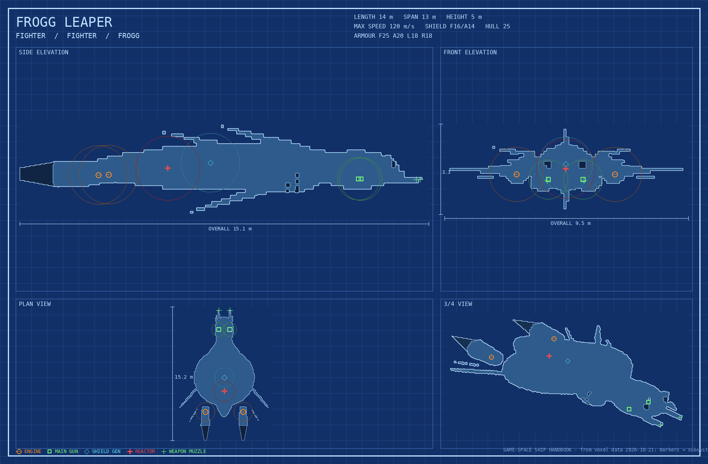
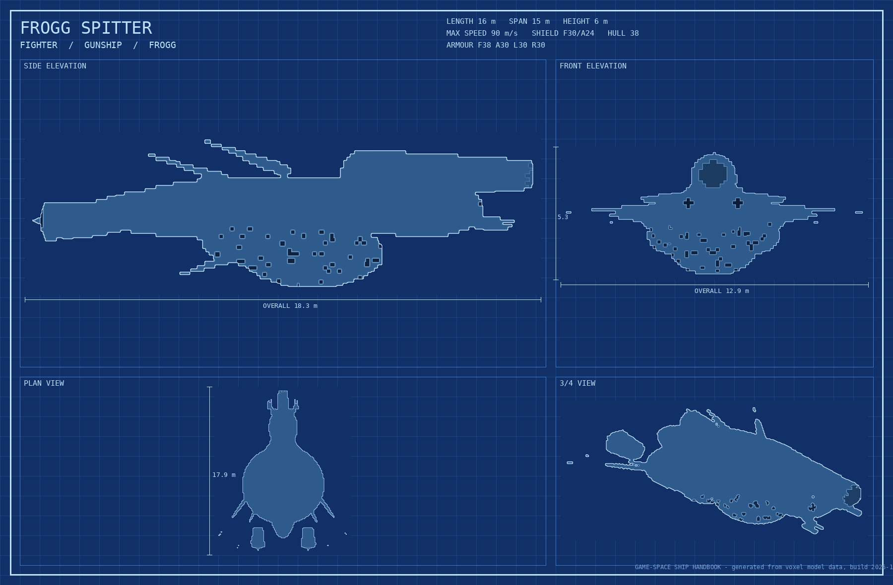
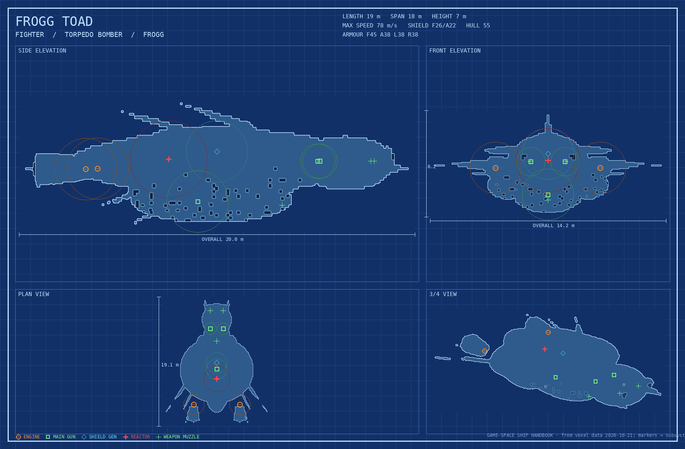
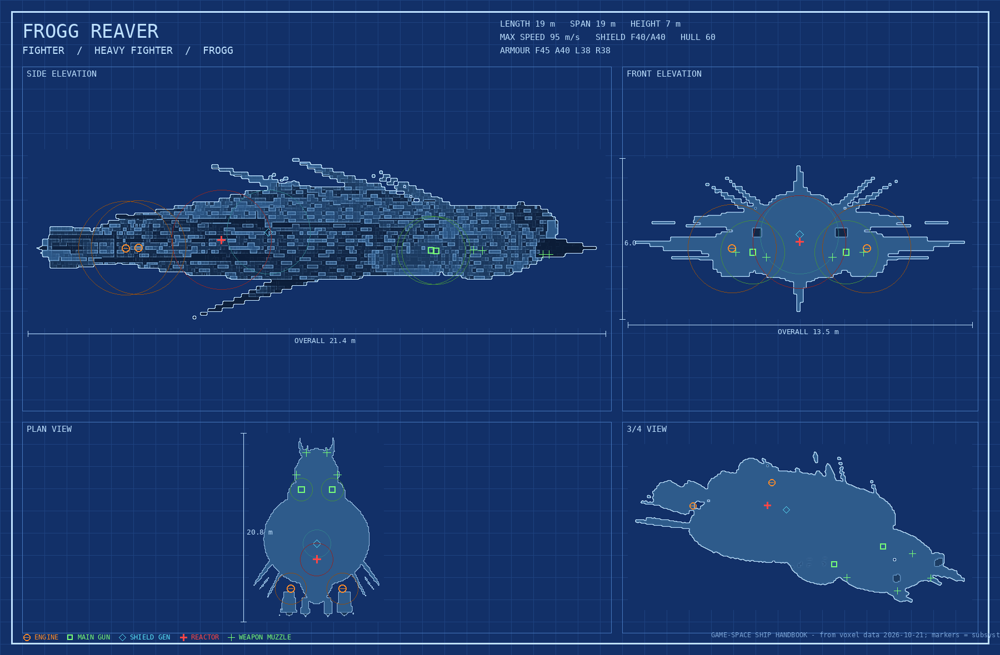
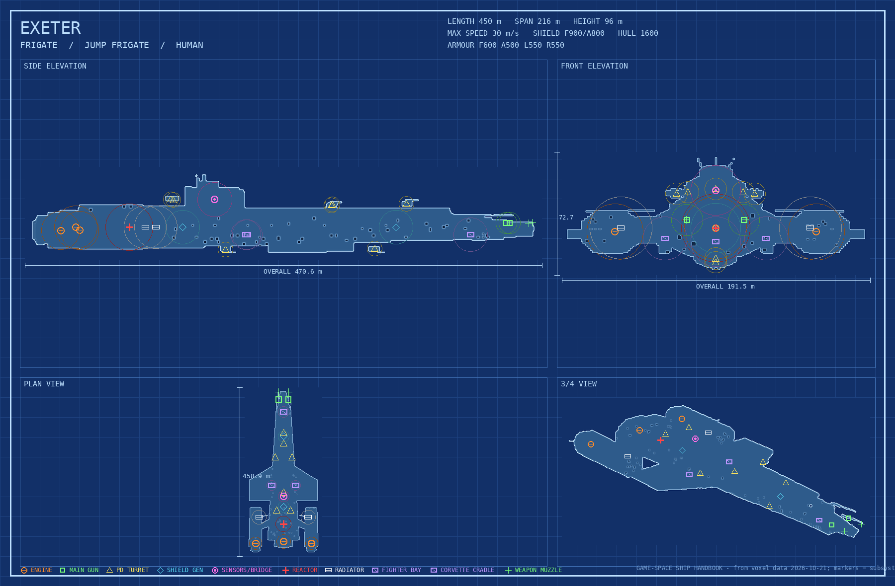
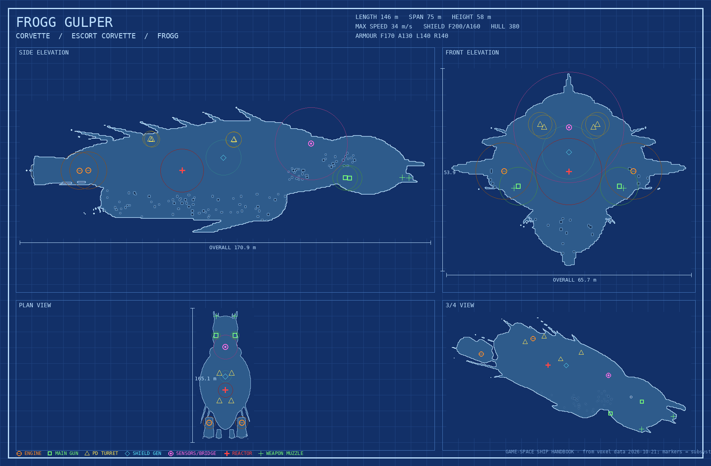
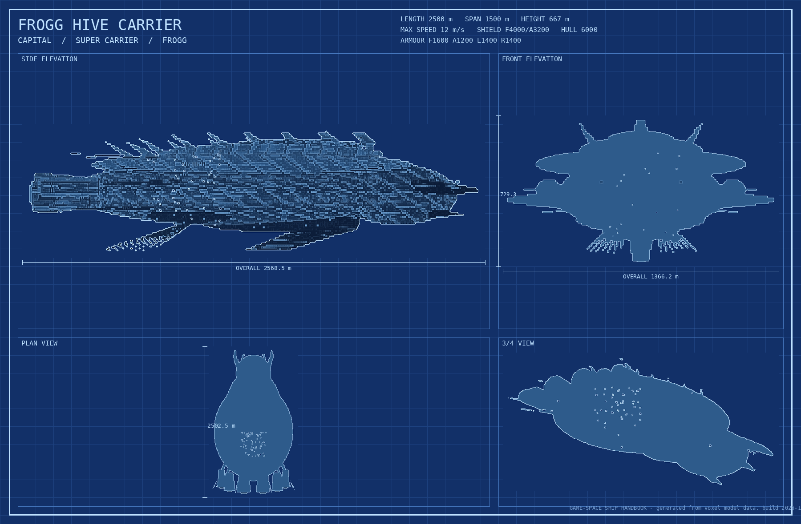

## 6. Known limits
- "Overall" dimensions include blades/spikes, so they exceed nominal `length` (e.g. Gulper 171 m overall vs 146 m).
- The 3/4 view is a flat-shaded silhouette plus edge shading, not a rendered art plate.
- Hive Carrier voxels are coarse (about 12 m per voxel); fine at catalogue distance, not for close flybys.
- No performance test of the 2.5 km model in the sim yet.

## 7. Exeter class (human frigate, 450 m)
Inspiration: owner-supplied angular grey/white frigate image (style only). Features: wedge hull, dorsal slab, bridge tower and mast,
bow hangar maw (12 fighters/drones), two side corvette cradles (2 corvettes), folded radiator panels (heat management for
PD lasers, docs/CAPITAL_COMBAT.md), outboard engine pods on pylons plus a central engine, 7 PD turret clusters, two
forward rails. Docking carries but does not repair or rearm. Hit points and PD weapon values are placeholders. Not yet used in missions.

## 8. Fighter drone (human, planned; owner brief 2026-10-21)
Auto wingman, smaller and more agile than the Kestrel (no pilot G-limit). Armament: one central (spinal) mag cannon and two
missiles. Behaviours: fly ahead as scouts, escort, attack on orders, and **ram ships to self-destruct** for damage.
Owner update 2026-10-21: 6 m long, small shield only, 48 per frigate, lost until replenished, slaved 1 per fighter / 2 per heavy fighter / 6 per corvette (docs/FLEET_LOGIC.md 9a). Model targets (placeholders, to tune): length 6 m, turn rate above Kestrel, low shield, very low hull. Needs: subsystem
set (engine, cannon, missile rail, sensor, core), marker rendering like all models, ram-damage rule (see docs/FLEET_LOGIC.md
section 9). Open: jamming rules (later).

## 9. Surface detail (high detail only; added 2026-10-21)
Owner feedback: models read as simple shapes stacked. The voxeliser (`src/20_voxel.js`, `surfaceDetail()`) now adds a
deterministic procedural layer (hash-based, no `Math.random`) that only exists above the default detail.
| Tier | Detail index (voxels / 12 m) | Adds |
|---|---|---|
| 0 | 0-4 (24-112, default mid) | nothing; models identical to before, no extra cost (only the FROGG palette was changed) |
| 1 | 5 (160) | panel plating (seams, per-panel tint, accent panels), convex-edge wear, engine soot, scratches, lit windows (`win`), `paint` and `text` decals, structured light lattices instead of random dots |
| 2 | 6 (224) | relief plating (raised panels), recessed seams, greebles (blocks, slatted vents, hatches, domes, tanks, masts, light rows; FROGG: armour scales, spikes, gill vents with glowing slits, knobs, ridges), grooves/conduits/glow veins, contact shading, prims with `lod: 2` |
| 3 | 7 (288) | ~1.6x greeble density, 15% smaller panels, wider trenches, prims with `lod: 3` |
Resolutions below 120 voxels (HUD icons) never get detail. Ships capped by `RES_CAP` (corvettes/frigates) have the same voxel size at 6 and 7; only the tier-3 extras differ.

**Adding detail to a ship** (all in the ship's `prims` array; coordinates are authored size and scale with `scaleShip`):
- `lod: 2` or `lod: 3` in any prim's options: built only at that tier or above (use for pylons, ribs, radiators, nozzle petals, canopy frames). Helpers: `ringSegs`, `rungs`, `paintGrid` (20_voxel.js), `fDetail` (FROGG kit, 31_ships_frogg.js).
- `win: {col, p, f, pu, pv, wu, o}` on a prim: lit windows on its side faces.
- `{t:'paint', box:[x0,y0,z0,x1,y1,z1], col, side:'top'|'bottom'|'side'|'+x'.., mix}`: stripes, hatches (surface cells only, mirrored).
- `{t:'text', c, face:'+x'|'-x'|'+y'|'-y', text, px, col}`: 3x5 pixel text (`px` = metres per pixel; skipped if under 0.9 voxel).
- `noDetail: true` on a prim (no relief/greebles), `def.noDetail`, `def.noDetailZones:[{c,r}]`, `def.detail = {style, raise, greeb, accent...}`, `def.rustK` (FROGG rust strength). Engines and mounts are excluded from greebles automatically.
Cost (headless CPU, ms; instances): Kestrel 12.3k at mid, 61k / 107k at detail 6 / 7 (was 55k / 94k); Gulper 191k / 195k (was 168k); build time per ship is under 2.1 s even for the Gulper (rasterisation was also made faster with tight prim bounds; the old Gulper took 2.7 s). Screenshots: `img/detail/sheet_d4.png`, `sheet_d7_before.png`, `sheet_d7_after.png`, `cmp_<ship>.png` (before | after).

## 10. Shipyard workbench

Open `index.html?yard` for a new blank model, or `index.html?yard=kestrel` to load a ship. The Shipyard reuses the runtime voxeliser; it is a separate visual/design mode, and normal gameplay URLs are unchanged.

- Choose a ship or **NEW** from the picker. Drag to orbit, use the wheel to zoom, or pinch on touch. The grid has one-metre ticks; the cyan top-view outline is a 12.4 m Kestrel scale reference.
- Use **Frame ship**, **Front**, **Side**, **Top**, and **3/4** to set the camera. Initial framing fits the authored hull; the 600 m Bullfrog is supported. Collapse the left panel to expose more of the model.
- The size readout shows authored and in-game length. Ships changed by `scaleShip` (for example, the 64 m Halberd scaled to 128 m) can be previewed at that in-game scale; the editor coordinates and copied geometry remain authored-scale.
- Edit the **PRIMS JS SOURCE** as a plain object array or literal helper-call array. Supported helpers are `tap`, `box`, `ell`, `seg`, `chain`, `ringSegs`, and `rungs`; helper arguments must be literal values and object options, not arbitrary JavaScript expressions. Primitive helpers expand through the game's own constructors. Edits rebuild after a short debounce. Parse or build errors appear below the editor and keep the last successfully built model.
- The database-entry JSON editor validates weapon ids, mount/turret and engine component references, stores, armour/class coverage, positive component HP, and hex colours. Markers update from the edited entry. Invalid database data is reported inline and is not written to `data/db.json`.
- Toggle component, mount, turret, and engine markers; the half-extents box; mirroring; voxel detail (`DETAIL_STEPS`); and LOD step reduction. Suggested `half` and `radius` values come from primitive bounds. **Apply suggested bounds** updates the JSON editor only; copy and paste the entry into `data/db.json` yourself if wanted.
- **New ship from template** copies the Kestrel, Halberd, or Exeter prims into a new workbench model and starts an empty technical entry. Its ID must be a unique lowercase slug before the entry validates.
- Choose helper-call or plain-JSON format before **Copy prims JS**. **Copy db entry (JSON)** copies the current entry, and **Save PNG sheet** downloads a labelled 900 × 540 3/4, top, side, and front contact sheet. The workbench does not write to source files or save images into the repository.
